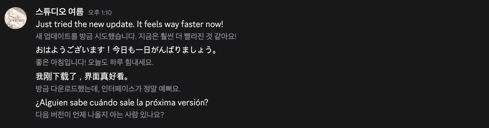
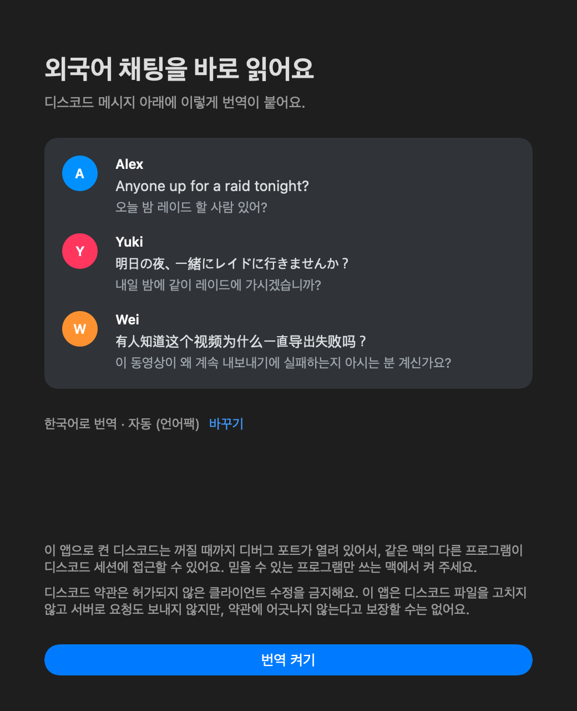

# 디스코드 번역

디스코드 데스크톱 앱(맥)의 외국어 메시지 바로 아래에 번역을 표시합니다.
번역은 맥 내장 번역 기능을 써서 무료입니다. 이 앱은 메시지를 어디로도 보내지 않습니다.

https://github.com/user-attachments/assets/1c943337-9475-440f-99a0-7ac2efc3708a



## 설치

1. [Releases](https://github.com/datell1357/DiscordTranslator/releases/latest)에서 `DiscordTranslator-버전.zip`을 받아 압축을 풉니다.
2. `디스코드 번역.app`을 `응용 프로그램` 폴더로 옮기고 실행합니다.

애플 공증을 받은 앱이라 처음 실행할 때 따로 허용할 필요가 없습니다.

## 사용법



처음 실행하면 안내 창이 뜹니다. 샘플 메시지가 실제로 번역되는 모습과 아래 [알아둘 점](#알아둘-점)의 디버그 포트·디스코드 약관 고지를 보고 `번역 켜기`를 누르면 디스코드가 번역 모드로 켜집니다. 번역될 언어는 시스템 언어로, 번역 모델은 자동으로 정해지고 `바꾸기`에서 고를 수 있습니다. 창을 그냥 닫으면 디스코드를 건드리지 않고 앱이 끝나며, 다음 실행 때 안내가 다시 뜹니다.

번역을 켜면 첫 번역이 붙을 때까지 화면 오른쪽 위에 작은 안내가 남아 있습니다. 첫 번역이 붙은 뒤에 `로그인할 때 시작`을 물어봅니다. 자동 모델이 언어팩 없이 긴 글을 오래 번역하면 언어팩을 한 번 권합니다.

그다음부터는 실행하면 바로 디스코드가 번역 모드로 켜집니다. 디스코드가 이미 켜져 있으면 다시 시작할지 먼저 묻습니다.

- **상단 막대 아이콘:** 앱은 Dock에 나오지 않고 화면 위쪽 막대에만 있습니다. 아이콘을 누르면 설정 창이 열립니다. 창 맨 위 줄에서 지금 상태를 보고 `종료`로 앱을 끝냅니다. 디스코드가 꺼져 있거나 번역 없이 켜져 있으면 같은 줄에 `번역 모드로 켜기`나 `다시 시작` 버튼이 나옵니다. 막대가 꽉 차 아이콘이 가려지면 앱을 다시 실행하세요. 디스코드가 꺼져 있으면 번역 모드로 켜고, 번역 없이 켜져 있으면 다시 시작할지 묻고, 그 밖에는 설정을 엽니다.
- **번역 줄 숨기기/보이기:** 디스코드 안에서 `Ctrl+Shift+T`
- **끝내기:** 디스코드를 종료하면 1분 뒤 함께 끝납니다. 업데이트로 잠깐 꺼진 경우를 구분하려고 기다립니다. `로그인할 때 시작`을 켜 두면 앱은 남아 있으니 설정 창 맨 위의 `종료`로 끝냅니다.
- **번역 없이 쓰기:** 이 앱을 켜지 않고 디스코드를 평소처럼 켜면 원래 상태 그대로입니다.

필요 환경: Apple 칩 맥, macOS 26 이상.

## 설정

상단 막대 아이콘을 누르면 뜨는 설정 창에서 바꿉니다.

- **번역될 언어:** 이 맥에서 바로 쓸 수 있는 언어 중에 고릅니다. 바꾸면 켜 둔 채로 화면의 번역이 그 언어로 바뀝니다.
- **번역 모델:** Apple Intelligence를 쓸 수 있는 맥(macOS 26.4 이상)에만 나옵니다. 기본은 `자동`으로, 언어팩이 있는 언어는 언어팩으로, 나머지는 Apple Intelligence로 옮깁니다. 언어팩이 훨씬 빠릅니다(아래 알아둘 점). `Apple Intelligence`나 `언어팩`을 직접 고르면 그 선택을 유지합니다. 언어팩이 없을 때 `언어팩`을 고르면 다 받은 뒤에 바뀝니다.
- **언어팩:** 받은 언어팩을 언어별로 보고 바로 받을 수 있습니다. 지우기는 애플이 앱에 열어 두지 않아서 `시스템 설정 > 일반 > 언어 및 지역 > 번역 언어…`의 `제거`로 합니다. 제거하면 앱에도 반영됩니다.
- **로그인할 때 시작:** 로그인하면 앱과 함께 디스코드도 번역 모드로 켜집니다. 디스코드가 먼저 켜져 있으면 다시 시작할지 묻습니다. 켜 두면 디스코드를 꺼도 앱이 남아 있다가, 디스코드가 번역 없이 다시 켜질 때 번역 모드로 바꿉니다.
- **묻지 않고 디스코드 다시 시작:** 위 질문 없이 바로 다시 시작합니다. 음성 채널에 들어가 있어도 연결이 끊기니 주의하세요.
- **알아둘 점:** 안내 창에서 본 디버그 포트·디스코드 약관 고지를 다시 볼 수 있습니다.

## 번역 언어

번역은 앱에 들어 있지 않고 맥의 번역 기능을 씁니다.

- **Apple Intelligence를 켠 맥:** 언어를 따로 받지 않아도 바로 됩니다. 언어팩을 받으면 켜 둔 채로 언어팩 번역으로 바뀌어 훨씬 빨라집니다.
- **그 밖의 맥:** 언어팩을 받아야 합니다. 없으면 설정 창이 뜨니 `언어 받기`를 누르거나 시스템 설정의 번역 언어에서 받으세요. 받으면 앱을 다시 켜지 않아도 바로 번역을 시작합니다.

Apple Intelligence는 필수가 아니고, 이 앱이 켜거나 켜라고 권하지 않습니다. 받은 언어팩은 맥의 다른 앱과 함께 씁니다.

원문 언어는 메시지마다 앱이 판별합니다. 번역될 언어와 같은 글은 건너뛰고, 여러 언어가 섞인 글은 줄마다 판별합니다. 언어팩은 언어 단위라서 원문 언어와 번역될 언어의 언어팩이 모두 있어야 합니다. `lol`, `gg`, 이름처럼 짧아서 언어를 확신할 수 없는 글은 번역하지 않습니다.

## 새 버전 알림

하루에 한 번 GitHub Releases에서 최신 버전 번호를 확인합니다. 새 버전이 있으면 상단 막대 아이콘 옆에 빨간 점이 뜨고, 설정 창에서 내려받는 페이지를 열 수 있습니다. 자동으로 내려받거나 설치하지는 않습니다. 이때 GitHub에 보내는 것은 일반적인 웹 요청 정보뿐이고 메시지 내용은 보내지 않습니다.

## 용어집

자주 틀리는 표현은 `~/Library/Application Support/DiscordTranslator/glossary.txt`에 적어 고칩니다. 처음 실행할 때 [기본 파일](Resources/glossary.txt)이 복사되고, 저장하면 켜 둔 채로 바로 적용됩니다.

```text
# 왼쪽에 영어 알파벳 밖의 글자(한글 등)가 있으면 번역이 끝난 뒤에 글자를 바꿉니다.
동시 세대 = 동시 생성

# 왼쪽이 영어 알파벳뿐이면 번역 전에 영어 원문을 바꿉니다. 번역기가 모르는 속어를 풀어 줄 때 씁니다.
goes hard = is really great
```

적어 둔 표현만 고칩니다. 새 속어나 문맥에 따라 뜻이 달라지는 오역은 그대로 남습니다. 번역 뒤 규칙은 프랑스어처럼 영어 알파벳을 쓰는 언어에서는 악센트 있는 글자가 왼쪽에 있어야 합니다.

## 동작 방식

1. 디스코드를 `--remote-debugging-port` 옵션으로 실행합니다. 앱 파일은 고치지 않습니다.
2. `Resources/inject.js`가 화면의 메시지와 임베드 글을 읽어 도우미로 넘깁니다.
3. 도우미(`Sources/main.swift`)가 언어를 판별하고 Apple Translation으로 번역해 돌려줍니다. 멘션과 채널 이름은 번역하지 않고 그대로 둡니다.
4. 번역문을 메시지 아래에 글자로만 넣습니다. 디스코드 서버로는 아무 요청도 보내지 않습니다.

## 알아둘 점

- 이 앱으로 켠 디스코드는 꺼질 때까지 디버그 포트가 이 맥 내부(127.0.0.1)에 열려 있습니다. 번역 앱만 꺼도 디스코드를 다시 켜기 전까지는 닫히지 않습니다. 같은 맥의 다른 프로그램은 이 포트로 디스코드 세션에 접근할 수 있습니다.
- 디스코드 약관은 허가되지 않은 클라이언트 수정을 금지합니다. 이 방식은 파일을 고치지 않고 서버 요청도 보내지 않지만, 약관에 저촉되지 않는다고 보장할 수는 없습니다.
- 메시지 본문과 임베드(봇 공지, 링크 미리보기)의 제목·설명·항목을 번역합니다. 스포일러로 가린 글은 번역 줄에서 `███`로 가립니다. 글이 6,000자를 넘으면 앞부분만 번역하고 끝에 `…`을 붙입니다. 채널 이름, 이미지 속 글자는 번역하지 않습니다.
- 150자 줄 번역에 Apple Intelligence 모델은 약 1초, 언어팩 모델은 약 0.06초 걸립니다(M5 Ultra에서 측정). 동시에 돌려도 빨라지지 않습니다. 화면에 보이는 메시지부터 한 개씩 번역하고, 스크롤하면 새로 보이는 곳을 먼저 번역합니다. 처음 보는 채널에 긴 글이 많으면 전부 번역될 때까지 시간이 걸립니다.
- 번역이 0.4초를 넘으면 메시지 아래에 `번역 중…`을 표시하고, 긴 글은 끝난 줄부터 보여 줍니다. 채널을 옮기면 이전 채널의 남은 줄은 번역하지 않습니다. 끝난 줄은 저장되어 다시 번역하지 않습니다.
- 번역한 줄은 `~/Library/Caches/kr.yeoreum.discord-translator/lines-v2.jsonl`에 저장해 앱을 다시 켜도 바로 표시합니다. 원문은 해시로만 남지만 **번역문은 글자 그대로 남습니다.** 파일은 본인 계정만 읽을 수 있고, 최근 2만 줄만 유지합니다. 지금은 저장을 끄는 설정이 없으니 남기고 싶지 않으면 이 파일을 지우세요.
- 디스코드가 업데이트로 스스로 다시 켜지면 실행 옵션이 사라집니다. 번역 앱이 이를 감지해 번역 모드로 다시 켜고, 앱 시작 후 2분이 지났다면 먼저 묻습니다.
- 로그(`~/Library/Logs/DiscordTranslator.log`)에는 메시지 내용을 남기지 않습니다. 온보딩 단계별 시각도 여기에만 남고 밖으로 보내지 않습니다. 파일은 본인만 읽을 수 있고, 1MB를 넘으면 `.log.1`로 넘겨 하나만 더 남깁니다.
- 팝아웃 창은 번역하지 않습니다.

## 직접 빌드

```bash
./build.sh
```

`build/디스코드 번역.app`이 만들어집니다.

## 공개용 빌드

`build.sh`는 임시 서명이라 다른 맥에서는 macOS가 막습니다. 공개할 때는 Developer ID 인증서와 공증 자격을 한 번 등록한 뒤 `tools/release.sh`를 실행합니다.

```bash
xcrun notarytool store-credentials "discord-translator" --apple-id "이메일" --team-id "팀ID"
```

```bash
tools/release.sh
```

## 시험

실행 중인 디스코드를 건드리지 않고, 헤드리스 크롬의 모의 화면으로 시험합니다.

```bash
node test/run-mock.mjs
```

언어팩 대기, 번역 모델 전환, 디스코드 재시작 승인, 상주, 새 버전 알림은 가짜 디스코드 앱으로 시험합니다.

```bash
node test/run-flow.mjs
```

스포일러, 번역 앱만 꺼진 경우, 일시적인 번역 실패는 따로 시험합니다.

```bash
node test/run-resilience.mjs
```

앱 아이콘은 `tools/make-icon.sh`로 다시 만듭니다.

## 라이선스

MIT. [LICENSE](LICENSE)를 보세요.
